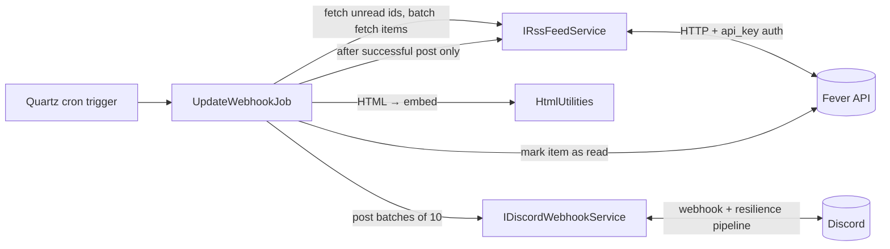

# FeverCord

[](https://github.com/dev-NC/fevercord/actions/workflows/ci.yml)

A .NET 8 background service that polls a [Fever](https://feedafever.com/) RSS
reader for unread items and delivers them to a Discord channel as rich embeds
on a schedule.

## Why I built this

[FreshRSS](https://www.freshrss.org/) has a Fever-compatible API but no native
Discord webhook support, so I built this glue service.

## Features

- Polls the Fever API on a Quartz.NET cron schedule (default: every 5 minutes)
- Converts feed items to Discord embeds (HTML → plain text, first image extracted)
- Respects Discord limits: 10 embeds per message and a 6,000-character budget per request
- Batched fetching (50 items/request) and batched posting
- At-least-once delivery: items are marked read **only after** a successful post
- Resilience against transient failures: retries with jitter, circuit breaker,
  rate limiter, layered timeouts
- Runs as a Windows Service or in a container

## Architecture


On each tick, the job fetches unread item IDs, batches them into fetch requests,
converts each item to an embed, posts them in groups of up to 10, and marks only
the successfully posted items as read.

## Tech stack

| Concern | Choice | Why |
|---|---|---|
| Runtime | .NET 8 Worker Service | long-running background work without the ASP.NET surface area |
| Scheduling | Quartz.NET | cron expressions from config, `[DisallowConcurrentExecution]` |
| Resilience | Polly (`Microsoft.Extensions.Http.Resilience`) | honors Discord's `Retry-After` on 429s and fails fast when the API is down |
| HTML → text | HtmlAgilityPack | tolerant parsing of real-world feed HTML |
| Tests | xUnit | 56 tests covering job semantics, batching, embed budgets, HTTP contracts, and config validation |

## Configuration

**Secrets** (via `dotnet user-secrets` in dev, environment variables in production):

| Key | Description |
|---|---|
| `FeverSecrets__RssApiKey` | Fever API key |
| `FeverSecrets__RssBaseAddress` | Fever server base URL |
| `DiscordSecrets__DiscordWebhook` | Full Discord webhook URL |

**Settings** (`appsettings.json`):

| Key | Default | Description |
|---|---|---|
| `Fever:RssItemFetchLimit` | `50` | max items per Fever API request |
| `Discord:DiscordRequestLimit` / `Discord:DiscordRequestWindow` | `30` / `60` | outbound rate limit: 30 requests per 60 s |
| `Discord:DiscordEmbedLimit` | `10` | embeds per webhook message |
| `Discord:DiscordEmbedColor` | `12058620` | embed accent color (decimal RGB) |
| `Quartz:UpdateWebhookJob` | `0 */5 * ? * *` | job cron schedule |

```bash
dotnet user-secrets set "FeverSecrets:RssApiKey" "<key>" --project src/FeverCord
dotnet user-secrets set "FeverSecrets:RssBaseAddress" "https://your-fever-server/" --project src/FeverCord
dotnet user-secrets set "DiscordSecrets:DiscordWebhook" "https://discord.com/api/webhooks/..." --project src/FeverCord

dotnet run --project src/FeverCord
```

## Design decisions & tradeoffs

1. **At-least-once delivery.** Items are marked read only after the webhook post
   succeeds. If the process dies mid-run, items are re-sent, so duplicates are
   possible. I chose duplicates over silently losing items. Exactly-once would
   require a persistent idempotency store (e.g. a local DB of posted item IDs);
   for a single-user tool that felt like overkill, and I noted it as the natural
   next step.
2. **Custom Discord resilience pipeline** instead of the standard handler: Discord
   429 responses return `Retry-After`, and one webhook has tight per-route limits,
   so I use a dedicated fixed-window rate limiter + `ShouldRetryAfterHeader` +
   a circuit breaker to fail fast when Discord is down rather than burning retries.
3. **6,000-character embed budget.** Discord caps total embed text per message;
   batches that exceed it get split by re-queueing. A single embed larger than the
   budget on its own still fails that run — rare in practice because titles and
   descriptions are truncated, but not impossible.

## Known limitations / roadmap

- The author name is not truncated, so a very long author could push a single
  embed over the 6,000-char budget and fail that batch
- Delivery is at-least-once, not exactly-once (see design decisions)
- No metrics/health endpoint yet — planned: OpenTelemetry counters + a heartbeat log

## Development

```bash
dotnet build FeverCord.sln   # build
dotnet test                  # tests (56 passing, ~75% line coverage)

dotnet test --collect:"XPlat Code Coverage"   # coverage report (coverlet)
```

### Running in Docker

```bash
docker build -t fevercord src/FeverCord

docker run --rm \
  -e FeverSecrets__RssApiKey="<key>" \
  -e FeverSecrets__RssBaseAddress="https://your-fever-server/" \
  -e DiscordSecrets__DiscordWebhook="https://discord.com/api/webhooks/..." \
  fevercord
```

The container gets its configuration from environment variables (user-secrets are a
development convenience). Missing or malformed config fails fast at startup with an
error naming the offending key.

> **Note on naming:** the project/assembly is `FeverCord`, but all namespaces and the
> Windows service name are `FeverCordSvc`. This is intentional legacy from restructuring.

## License

MIT — see [LICENSE](LICENSE).

Contains attributed MIT-licensed code from:
- [andrewlock.net — Using Quartz.NET with ASP.NET Core and Worker Services](https://andrewlock.net/using-quartz-net-with-asp-net-core-and-worker-services/)
- [ReadSharp](https://github.com/ceee/ReadSharp) (`HtmlUtilities`)
